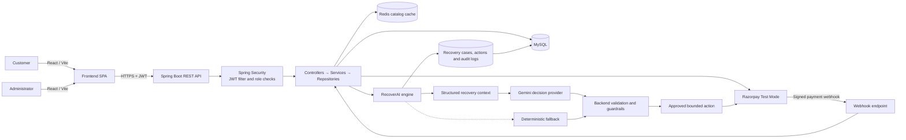
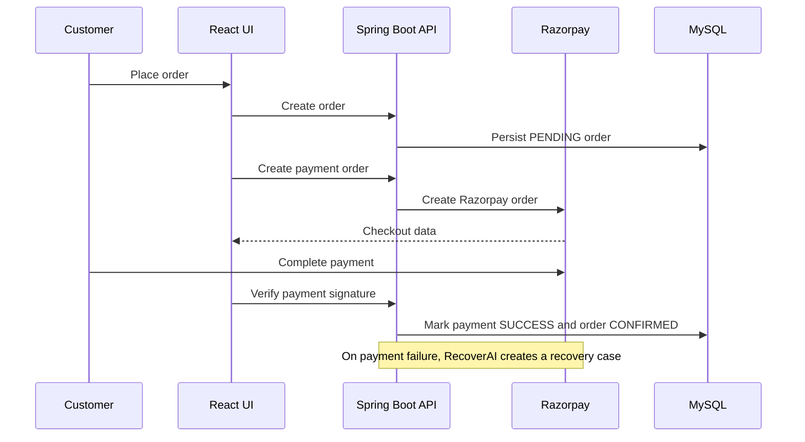
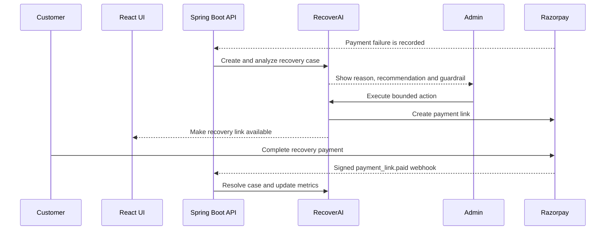

# NexCart | RecoverAI

> An electronics marketplace with **RecoverAI** — a built-in revenue recovery layer that detects failed payments, recommends safe interventions, and turns lost checkout intent into measurable recovered revenue.

## Why NexCart

Failed payments are a silent e-commerce revenue leak. A customer may still intend to buy, but a timeout, bank decline, or interrupted checkout leaves the order unfinished. Most products either stop at the failure or rely on an unrestricted AI agent to act on financial data.

NexCart closes the loop safely. Its **RecoverAI** module detects a failed payment, diagnoses the context, recommends one permitted intervention, applies backend guardrails, and measures whether revenue was actually recovered.

AI informs the decision; deterministic application code controls execution.

## Product at a glance

| Audience | What they can do |
| --- | --- |
| **Visitor** | Browse products, brands, categories, product details, and reviews; register or sign in. |
| **Customer** | Search and filter products, manage cart and wishlist, save addresses, apply coupons, complete Razorpay checkout, view orders, and use an available recovery payment link. |
| **Admin** | Manage the catalog and operational data, inspect RecoverAI cases, review decisions and audit events, execute bounded actions, and monitor recovery metrics. |

### Core capabilities

- **Commerce:** Product catalog, category and brand discovery, search, filtering, sorting, pagination, reviews, cart, wishlist, profile, addresses, coupons, and orders.
- **Payments:** Razorpay Test Mode checkout, server-side payment-signature verification, and signature-verified Razorpay webhooks.
- **Role protection:** JWT authentication, BCrypt password hashing, customer-owned data checks, and admin-only routes and APIs.
- **Operations:** Catalog, category, brand, coupon, user, address, order, payment, and review administration APIs.
- **RecoverAI:** Automatic failure detection, structured decisioning, guardrails, payment-link recovery, audit history, and real/simulated metrics.

## RecoverAI — bounded AI revenue recovery

RecoverAI follows a closed recovery loop:

```text
DETECT → DIAGNOSE → DECIDE → VALIDATE → ACT → MEASURE
```

1. A checkout failure creates a persistent recovery case with the order amount and failure reason.
2. Gemini, when configured, receives a minimal structured recovery context and recommends one action.
3. If Gemini is unavailable, times out, or returns invalid output, deterministic rules take over.
4. The backend validates the recommendation and calculates expected recovery itself.
5. An admin executes an approved bounded action, such as creating a Razorpay payment link.
6. The customer completes the pending order through the link shown on their Order Details page.
7. A signed `payment_link.paid` webhook verifies the outcome, confirms the order, resolves the case, and updates real recovered revenue.

### Guardrails by design

- AI cannot directly move money, modify order values, change permissions, access the database, or invoke Razorpay.
- The decision contract permits only `RETRY_PAYMENT`, `CREATE_PAYMENT_LINK`, and `NO_ACTION`.
- Recovery attempts are capped at **3** by default; payment retries are capped at **2**.
- Equivalent pending or completed retry/payment-link actions are not duplicated.
- Terminal cases — `RECOVERED`, `CUSTOMER_CANCELLED`, `EXHAUSTED`, `FAILED`, and `NO_ACTION` — cannot receive another action.
- Cancelling an order stops recovery and attempts to cancel its linked Razorpay payment link.
- Every decision, guardrail result, action, and outcome is retained in the recovery audit trail.

### Real and simulated recovery

| Mode | Purpose and behavior |
| --- | --- |
| **REAL** | Creates a Razorpay Test Mode payment link. A signed payment-link webhook verifies successful payment, confirms the order, and adds to real recovered revenue. |
| **SIMULATED** | Runs the recovery demonstration with a `simulated://` link. It does not contact Razorpay, make a real payment, send customer notifications, or change real order/payment state. Simulated amounts are excluded from real recovered-revenue metrics. |

The admin recovery view reports revenue at risk, recovered revenue, expected recovery, recovery rate, detected and recovered cases, action distribution, case details, and audit timelines.

### How the AI recovery agent works

RecoverAI uses Gemini as its primary server-side AI decision provider when `GEMINI_API_KEY` is configured.

Gemini receives a minimal structured recovery context containing relevant payment-failure information, order amount, recovery history, prior actions, order state, and payment-link state. It returns one bounded recommendation.

The backend validates the response and calculates expected recovery itself:

```text
Expected Recovery = Order Amount × Recovery Probability
```

Gemini does not control monetary calculations.

If Gemini is unavailable, times out, returns malformed or invalid output, or its API key is absent, the clearly labeled `DETERMINISTIC_FALLBACK` provider is used.

Each decision stores probability, expected recovery amount, confidence, risk level, reason, source, and guardrail result.

### AI agent boundary

Gemini analyzes recovery context and returns one bounded recommendation. It does not:

- Execute payments or invoke Razorpay APIs directly.
- Access Razorpay credentials.
- Modify MySQL, orders, or payment records.
- Bypass authentication, authorization, or guardrails.
- Make independent financial or permission changes.

The backend validates the AI decision. Guardrails determine whether it can execute. Razorpay performs payment operations, and signed webhooks confirm outcomes.

## Architecture

NexCart is a **modular monolith**. The commerce module and dedicated `recovery` package share a secure Spring Boot application and MySQL database while retaining clear package boundaries.



### Backend request flow

```text
Request → Controller → Service → Repository → MySQL
                     ↓
               DTO / Mapper response
```

Spring Security validates JWTs before protected routes reach controllers. Customers can access their own shopping and payment data; administrators can access `/api/admin/**`.

### Successful payment flow



### Recovery payment flow



### Order-list query measurement

Hibernate batch fetching is enabled for order items, products, and coupons to reduce per-row selects while keeping paginated order queries from joining a collection into the page query.

A MySQL-backed integration test measured SQL statements while serializing a page containing two orders and four distinct products:

- Before product batching: **9 SQL statements**
- After product batching: **6 SQL statements**
- Reduction for this fixture: approximately **33%**

RecoverAI dashboard metrics use database aggregates. The integration check measures **5 SQL statements for the combined metrics response**, independent of the number of cases.

These figures are test-fixture measurements; query counts for order serialization can vary with page contents.

## Technology stack

| Layer | Technologies |
| --- | --- |
| Frontend | React 19, Vite, React Router 7, Axios, Tailwind CSS 4 |
| Backend | Java 21, Spring Boot 3.5, Spring Web, Spring Security, Spring Data JPA |
| Data | MySQL 8, Hibernate/JPA, MapStruct |
| Caching | Redis |
| Authentication | JWT and BCrypt with `CUSTOMER` / `ADMIN` authorization |
| Payments | Razorpay Java SDK, Razorpay Test Mode, payment and webhook signature verification |
| AI decisioning | Google Gemini API, `gemini-2.5-flash`, deterministic fallback |
| Quality and docs | JUnit 5, Mockito, JaCoCo, ESLint, Maven, npm, Springdoc OpenAPI |
| Infrastructure | Docker, Docker Compose, Nginx, GitHub Actions |

## Repository structure

```text
NexCart/
├── frontend/
│   └── src/
│       ├── api/              # Axios clients, including admin recovery APIs
│       ├── components/       # Shared storefront components
│       ├── context/          # Authentication state
│       ├── pages/            # Customer, admin, and auth screens
│       └── routes/           # Protected and admin-only routes
├── backend/
│   └── src/main/java/com/nexcart/
│       ├── config/           # Application configuration
│       ├── controller/       # REST API endpoints
│       ├── dto/              # Request and response models
│       ├── entity/           # Commerce JPA entities
│       ├── mapper/           # DTO and entity mapping
│       ├── repository/       # Persistence layer
│       ├── security/         # JWT authentication and user details
│       ├── service/          # Commerce business logic
│       └── recovery/         # RecoverAI services, entities, APIs and webhooks
└── docs/
    ├── PRD.md
    └── RECOVERAI.md
```

## Run NexCart with Docker

### Prerequisites

- Docker Desktop on Windows/macOS or Docker Engine with the Docker Compose plugin on Linux.
- At least 4 GB of memory available to Docker.
- Razorpay Test Mode credentials.
- Optional: Gemini API key for Gemini-powered recovery decisions.

### Configure and start

From the repository root, copy `.env.example` to `.env` and replace the sample values with private values.

Choose a strong JWT secret and strong database passwords. The `.env` file is ignored by Git.

```powershell
Copy-Item .env.example .env
docker compose build
docker compose up -d
```

On macOS or Linux:

```bash
cp .env.example .env
docker compose build
docker compose up -d
```

Compose waits for MySQL's health check before starting Spring Boot. MySQL stores its data in a named volume. Running `docker compose down` preserves the database. Do not run `docker compose down -v` unless you intend to delete the database volume.

The frontend is served by Nginx and proxies `/api/` requests to Spring Boot. The default `FRONTEND_API_BASE_URL=/` works without a browser-visible backend hostname.

The backend port is bound to the host using the configured `BACKEND_PORT`. Swagger/OpenAPI is disabled by default in Compose (`OPENAPI_ENABLED=false`).

### Access and operations

| Service | URL |
| --- | --- |
| Frontend | `http://localhost:3000` |
| Backend API | `http://localhost:8081` |
| Swagger UI (when enabled) | `http://localhost:8081/swagger-ui/index.html` |
| Backend health | `http://localhost:8081/actuator/health` |
| Backend readiness | `http://localhost:8081/actuator/health/readiness` |

The ports can be changed through the environment configuration.

Useful Docker commands:

```powershell
docker compose ps
docker compose logs -f
docker compose logs -f backend
docker compose down
```

### Docker implementation notes

- The backend image uses a Java 21 runtime and runs as a non-root user.
- MySQL remains the source of truth.
- Redis is used for catalog caching and supports an optional password.
- Backend startup does not depend on Redis availability; cache failures are logged and bypassed so catalog requests can continue against MySQL.
- Flyway owns schema changes, and Hibernate validates mappings instead of altering tables.
- `V1` creates a clean schema. Existing non-empty databases are baselined at version 1, and `V2` creates missing RecoverAI/webhook tables without removing existing rows.
- Review the existing database schema before the first production rollout.

Only health and info Actuator endpoints are exposed, with dependency details hidden.

## Key API endpoints

| Area | Base route | Examples |
| --- | --- | --- |
| Authentication | `/api/auth` | Register, login |
| Products | `/api/products` | List, search, product detail |
| Customer shopping | `/api/cart`, `/api/wishlist`, `/api/orders` | Cart, wishlist, checkout, orders |
| Payments | `/api/payments` | Config, create order, verify, failed |
| Admin | `/api/admin` | Product, order, user, payment management |
| RecoverAI | `/api/admin/recovery` | Metrics, cases, analyze, execute, simulate |
| Razorpay webhook | `/api/webhooks/razorpay` | Signed payment and payment-link events |

OpenAPI documentation is available through Swagger UI when `OPENAPI_ENABLED=true`.

## Local setup

### Prerequisites

- Java 21+
- Maven 3.9+
- Node.js and npm
- MySQL 8+
- Razorpay Test Mode credentials
- Optional: Gemini API key

### Configuration

Create a MySQL database named `nexcart`.

Use the repository-root `.env.example` as a reference for environment variables. For direct local development, configure the backend database connection and credentials.

Example:

```properties
SPRING_DATASOURCE_URL=jdbc:mysql://localhost:3306/nexcart
DB_USERNAME=YOUR_DB_USER
DB_PASSWORD=YOUR_DB_PASSWORD
JWT_SECRET=YOUR_LONG_RANDOM_SECRET
RAZORPAY_KEY_ID=rzp_test_...
RAZORPAY_KEY_SECRET=YOUR_RAZORPAY_SECRET
RAZORPAY_WEBHOOK_SECRET=YOUR_WEBHOOK_SECRET
RECOVERY_MAX_ATTEMPTS=3
GEMINI_API_KEY=YOUR_GEMINI_API_KEY
GEMINI_MODEL=gemini-2.5-flash
```

Never commit real credentials.

### Run locally

Terminal 1 — backend:

```bash
cd backend
mvn spring-boot:run
```

If you want the backend to use port `8081` directly, configure `SERVER_PORT=8081`. Otherwise, use the configured Spring Boot server port.

Terminal 2 — frontend:

```bash
cd frontend
npm install
npm run dev
```

Typical local development URLs:

| Service | URL |
| --- | --- |
| Frontend | `http://localhost:5173` |
| Backend | `http://localhost:8081` (when configured) |
| Swagger UI | `http://localhost:8081/swagger-ui/index.html` (when enabled) |

To demonstrate recovery payment completion, configure Razorpay to send signed events to:

```text
POST /api/webhooks/razorpay
```

Set the same `RAZORPAY_WEBHOOK_SECRET` in the backend.

## Verification

Backend tests:

```powershell
# Windows PowerShell
cd backend
./mvnw.cmd -B test

# macOS / Linux
cd backend
./mvnw -B test
```

Backend coverage:

```powershell
# Windows PowerShell
./mvnw.cmd -B -Pcoverage verify

# macOS / Linux
./mvnw -B -Pcoverage verify
```

Frontend checks:

```bash
cd frontend
npm run lint
npm run build
```

The project includes automated backend tests using JUnit and Mockito, frontend lint/build checks, and a JaCoCo coverage report.

## Production deployment preparation

Recommended topology:

- Serve the frontend container behind a TLS-enabled edge proxy.
- Route `/api` to the Spring Boot container on a private network.
- Use managed MySQL and Redis services that are not exposed to the public internet.
- Keep the backend private except for the edge proxy and Razorpay webhook delivery.

Before deployment:

1. Build and publish backend and frontend images through the CI workflow.
2. Provision managed MySQL and Redis.
3. Provide database, JWT, Razorpay, Gemini, and Redis credentials through the deployment platform's secret manager.
4. Set `CORS_ALLOWED_ORIGINS` to the exact frontend origin.
5. Configure liveness and readiness probes using the Actuator endpoints.
6. Configure the Razorpay webhook URL as `https://<api-host>/api/webhooks/razorpay`.
7. Keep payment credentials in Test Mode until production credentials and webhook delivery have been explicitly verified.

For an existing database, verify the live schema against the Flyway migrations before rollout. Back up the database before applying migrations. Do not use a schema reset as a migration strategy.

**Deployment status:** This repository's local Docker verification does not mean that cloud resources or a live production deployment have been completed.

### Known limitations

- Rate limits are per backend instance; use a shared gateway or distributed limiter before horizontal scaling.
- Redis is an optimization and is not the source of truth.
- Razorpay Test Mode does not demonstrate real-money production payment processing.
- Gemini decisioning requires a valid API key; deterministic fallback provides a recovery path when AI is unavailable.

## Security

- Never commit JWT, database, Razorpay, or Gemini secrets.
- Use environment variables or a secret manager for credentials.
- Rotate any credentials that have been exposed.
- Customer APIs enforce ownership checks.
- `/api/admin/**` requires the `ADMIN` role.
- Payment and webhook signatures are verified before payment, order, or recovery state changes.
- Public authentication routes skip JWT parsing, including when a browser sends an expired token left in storage; protected endpoints continue to enforce authentication and authorization.

## Documentation

- [Product requirements document](docs/PRD.md)
- [RecoverAI details](docs/RECOVERAI.md)

## Continuous integration

GitHub Actions runs frontend lint/build, backend tests and coverage, Compose validation, and backend/frontend image builds on pushes and pull requests.

Per-instance rate limits cover login, registration, payments, and admin recovery POST requests. Razorpay webhooks retain signature verification and are excluded from those limits.

---

NexCart demonstrates AI revenue recovery with a practical constraint: the system does not merely identify money at risk — it uses controlled actions, stopping rules, and a measurable audit trail to recover failed checkout intent.
