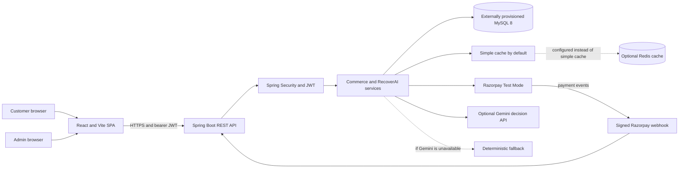
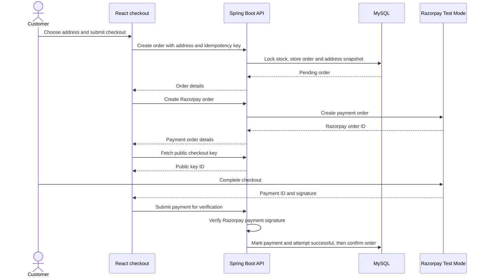
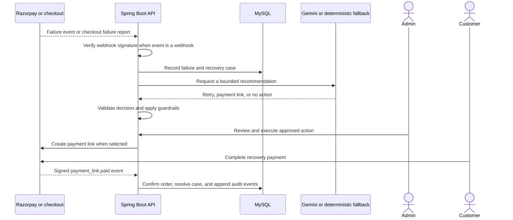
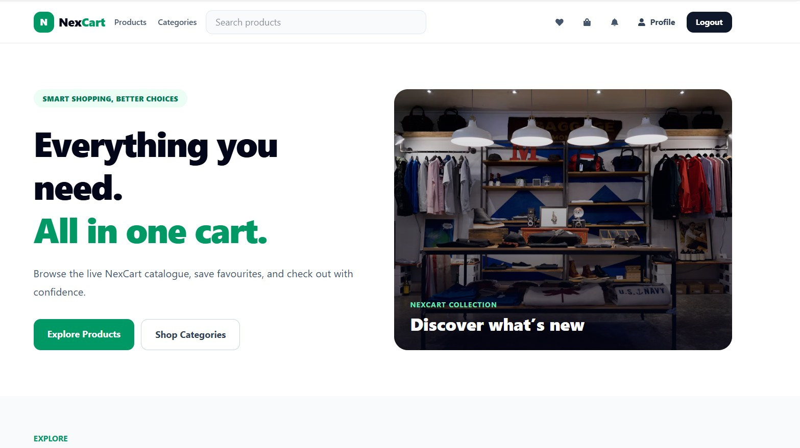
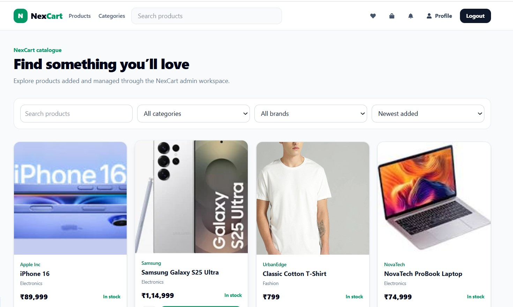
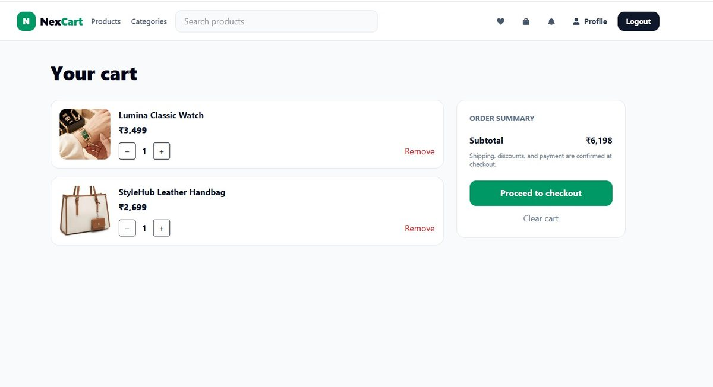
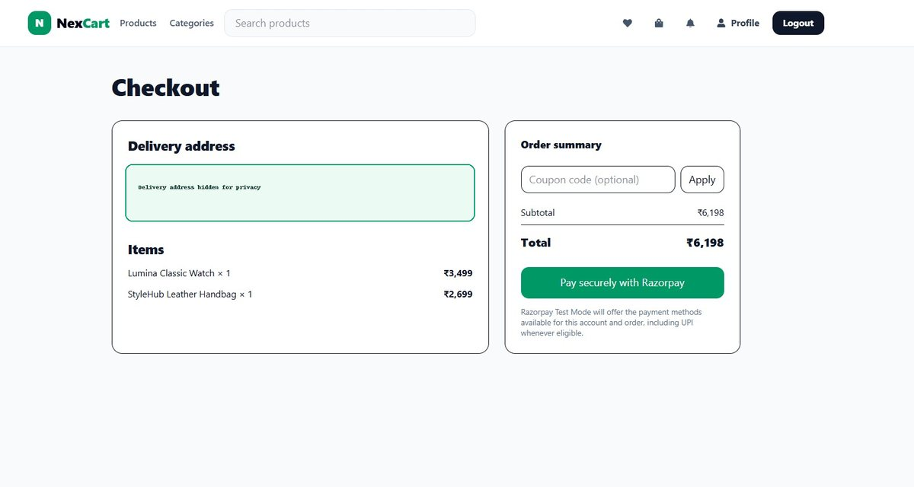
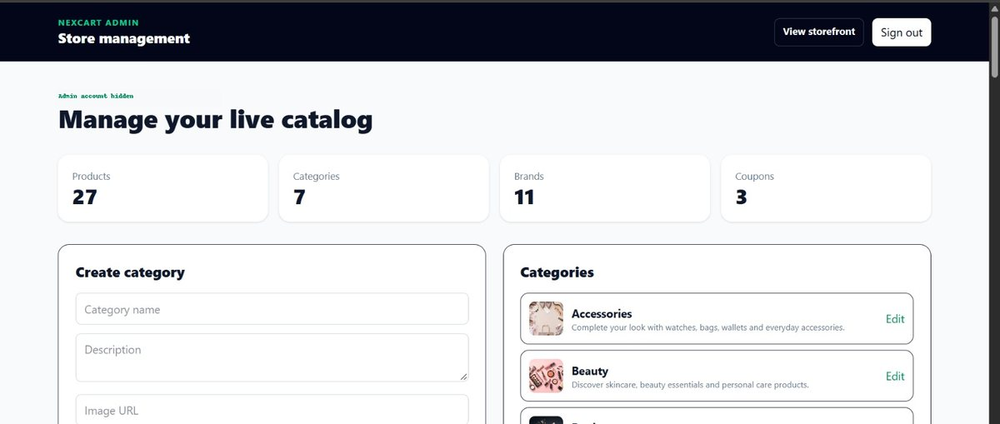
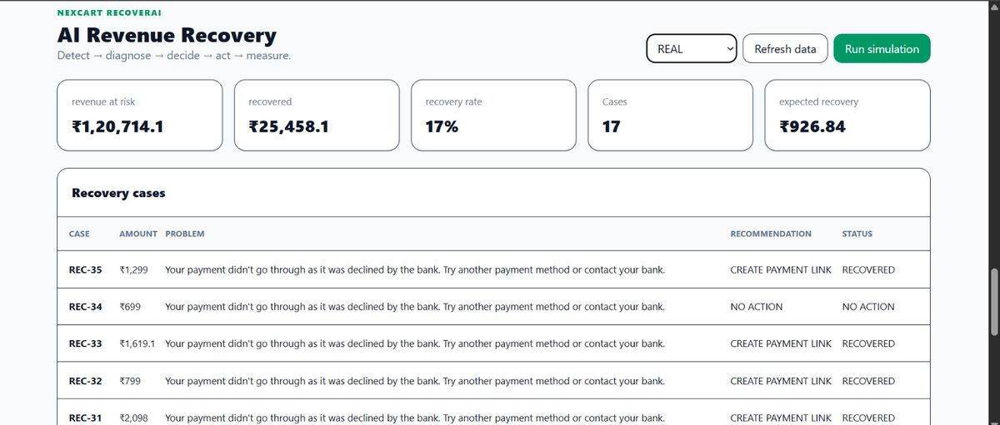

# NexCart

<p align="center"><strong>An electronics storefront with RecoverAI: a guarded payment-recovery workflow for failed checkout attempts.</strong></p>

<p align="center">
  <a href="#technology-stack"></a>
  <a href="#technology-stack"></a>
  <a href="#technology-stack"></a>
  <a href="#technology-stack"></a>
  <a href="#technology-stack"></a>
  <a href="https://github.com/swatipathak770/nexcart/actions/workflows/ci.yml"></a>
</p>

NexCart is a full-stack electronics commerce project built with React and Spring Boot. It demonstrates a complete customer checkout path and a RecoverAI workflow that turns payment failures into reviewable, bounded recovery actions.

> **Project status:** Portfolio project with Razorpay Test Mode integration. No live deployment or production readiness is claimed. CI builds and verifies the project; it does not publish images or deploy services.

## Contents

- [Overview and problem](#overview-and-problem)
- [Features](#features)
- [RecoverAI](#recoverai-payment-recovery)
- [Technology stack](#technology-stack)
- [Architecture and flows](#architecture-and-flows)
- [Screenshots](#screenshots)
- [Database and migrations](#database-and-migrations)
- [Repository structure](#repository-structure)
- [Local setup](#local-setup)
- [Environment variables](#environment-variables)
- [Run the applications](#run-the-applications)
- [Testing and CI](#testing-and-ci)
- [Docker Compose](#docker-compose)
- [Planned deployment](#planned-deployment)
- [Future improvements](#future-improvements)
- [Author](#author)

## Overview and problem

An online checkout can fail because a payment is declined, interrupted, or closed before completion. A customer may still want the order, but the store needs a safe way to recognize the failure and offer a supported next step.

NexCart pairs familiar storefront features with RecoverAI. The backend records payment state, prepares a structured recovery recommendation, applies deterministic guardrails, and stores an audit trail. AI can recommend an action; backend code and an administrator control whether it is executed.

## Features

### Customer capabilities

- Register and sign in; manage a profile and saved delivery addresses.
- Browse, search, filter, and sort products, categories, and brands.
- Manage a cart and wishlist, read and write product reviews, and apply coupons.
- Check out with a saved address, create an order, and pay with Razorpay Test Mode. Checkout uses an idempotency key and locks product stock to avoid duplicate orders and overselling.
- View order history and current order status; cancel eligible pending orders.
- Resume an available retry checkout or use an available recovery payment link.

Checkout copies the selected address fields onto the order as a delivery snapshot. Orders created before the V5 migration, or otherwise lacking a snapshot, may not show a delivery address.

### Admin capabilities

| Surface | Current capabilities |
| --- | --- |
| Frontend admin workspace | Manage products, categories, brands, and coupons; inspect RecoverAI cases, recommendations, metrics, and audit events; execute bounded recovery actions. |
| Backend admin APIs | Also includes endpoints for orders/status, payments, users, addresses, and reviews. These additional API areas do not currently have corresponding screens in the admin workspace. |

Public registration creates a `CUSTOMER` account. The repository does not seed an admin account or provide an admin sign-up flow; an admin role must be provisioned separately for a local demo. No demo credentials are published here.

### Feature boundaries

| Feature | Status | Notes |
| --- | --- | --- |
| Customer account, catalog, cart, wishlist, coupons, and checkout | Implemented | Covered by frontend routes and backend APIs. |
| Order history and status | Partially implemented | Current status is visible and an admin API can update it; there is no carrier integration or shipment tracking number. |
| Admin operations | Partially implemented | The backend API surface is broader than the current admin UI. |
| Payment-attempt history | Partially implemented | Attempts are persisted and updated internally, but there is no complete user-facing or admin history screen/API. V3's initial backfill is not a reconstruction of historical attempts. |
| Email/customer notifications | Not implemented | No email or push notification is sent by the recovery flow. |

### Security model

- The backend uses stateless JWT authentication, BCrypt password hashing, role checks, and customer-ownership checks.
- The frontend currently stores the JWT in browser localStorage.
- Request rate limits are in-memory and per backend instance.
- The backend verifies Razorpay payment signatures before confirming a successful checkout and verifies webhook signatures before processing webhook events.

These implementation details describe the current project; they are not a claim of production readiness.

### Selected API routes

| Area | Route |
| --- | --- |
| Registration/login | `/api/auth` |
| Product catalog | `/api/products`, `/api/categories`, `/api/brands` |
| Customer shopping | `/api/cart`, `/api/wishlist`, `/api/addresses`, `/api/orders` |
| Payments | `/api/payments` |
| Admin operations | `/api/admin/**` and selected `/api/user/users/**` routes |
| RecoverAI admin | `/api/admin/recovery` |
| Razorpay webhooks | `/api/webhooks/razorpay` |

## RecoverAI payment recovery

RecoverAI is a supervised decision workflow, not an autonomous payment agent:

1. A checkout failure report or verified Razorpay failure webhook triggers a recovery case.
2. The backend builds a structured context and asks Gemini for a bounded recommendation when `GEMINI_API_KEY` is configured.
3. If Gemini is missing, unavailable, times out, or returns invalid output, a deterministic provider supplies the recommendation.
4. The backend validates the decision, enforces attempt limits, and calculates the expected recovery amount itself.
5. An administrator reviews the case and executes an approved action. With the project's default `RAZORPAY_MODE=TEST`, the action creates a Razorpay Test Mode payment link or prepares a retry checkout.
6. The customer completes payment through the order details page or Razorpay link.
7. A signed, deduplicated `payment_link.paid` webhook confirms the recovered order and updates the case and audit trail.

RecoverAI decisions are limited to retry payment, create payment link, or no action. Recovery actions are capped at three by default; payment retries are capped at two. Gemini does not call Razorpay, change order amounts, or write application data.

**Simulated recovery is not a payment.** It demonstrates the admin workflow using simulated data. It does not contact Razorpay, send a customer notification, or change a real order/payment; simulated amounts are kept out of real recovered-revenue totals.

Razorpay Test Mode integration is implemented, but live transactions and live webhook delivery have not been verified. Webhooks are rejected when a webhook secret is not configured.

## Technology stack

| Layer | Technologies |
| --- | --- |
| Frontend | React 19, Vite 8, React Router 7, Axios, Tailwind CSS 4, React Hot Toast |
| Backend | Java 21, Spring Boot 3.5.16, Spring Web, Spring Security, Spring Data JPA, Hibernate |
| Persistence | MySQL 8 at runtime; Flyway migrations; H2 for automated tests |
| Authentication | JWT via JJWT and BCrypt password hashing |
| Payments and recovery | Razorpay Java SDK; Gemini API through Spring `RestClient`; deterministic recovery fallback |
| Caching | Spring Cache; simple in-process caching by default; optional Redis |
| Mapping and API docs | MapStruct and Springdoc OpenAPI |
| Build, tests, quality | Maven Wrapper, npm, JUnit 5, Mockito, Spring Boot Test, JaCoCo, ESLint |
| Delivery | Docker, Docker Compose, Nginx, GitHub Actions |

## Architecture and flows

NexCart is a modular monolith: commerce and recovery code run in one Spring Boot API and use the same MySQL database. The browser calls the API with a JWT for protected operations. Redis is optional; MySQL remains the durable source of truth. Docker Compose expects MySQL to be provisioned separately.

### Query behavior

The H2 integration-test fixture records six prepared statements when serializing a page with two orders and four products, and five statements for the combined RecoverAI metrics response. These are test-fixture counts, not production performance benchmarks; query counts vary with data and page contents.

### System architecture



Vercel for the SPA and Render for the backend are **planned hosting targets**, not deployed components.

### Checkout sequence



On failure or cancellation, the UI reports the result to the API; Razorpay can also report payment events through the signed webhook endpoint. Failure handling updates the current payment attempt and may create/analyze a recovery case.

### RecoverAI sequence



## Screenshots

These owner-provided captures show the local NexCart interface. The checkout delivery address and admin account name have been redacted. The RecoverAI dashboard is a local UI capture; its displayed values are not evidence of live payment transactions. No payment-link detail is included.

### Storefront and shopping










### Admin catalog



### RecoverAI



## Database and migrations

The backend uses MySQL 8 and Hibernate/JPA. Hibernate is configured to validate the schema; it does not create or update the production schema. The application has Flyway disabled by default so migrations can be run as a deliberate step using the Flyway Maven plugin configured at **11.7.2** in `backend/pom.xml`.

The schema includes customer/catalog data (`users`, `addresses`, `products`, `categories`, `brands`), shopping/order/payment data (`cart`, `wishlists`, `coupons`, `coupon_usages`, `orders`, `order_items`, `payments`, `payment_attempts`, `checkout_idempotency_keys`), and RecoverAI/webhook data (`recovery_cases`, `recovery_actions`, `recovery_audit_logs`, `processed_webhook_events`).

| Migration | Change | Data behavior |
| --- | --- | --- |
| V1 | Initial commerce, recovery, and webhook schema. | Creates the base tables. |
| V2 | Uses `CREATE TABLE IF NOT EXISTS` for recovery and webhook tables. | V1 already declares these tables, so V2 does not add them on a fresh V1 schema. |
| V3 | Creates payment-attempt table, indexes, and foreign keys. | Seeds attempt number 1 per existing payment by copying its **current** payment status and fields. It cannot reconstruct earlier provider attempts. Payment-level current status and attempt-level outcome can differ. Preserve independently recorded attempt rows; do not rerun this backfill over them. |
| V4 | Creates checkout idempotency keys with user/key and order uniqueness constraints. | Adds request deduplication storage. |
| V5 | Adds nullable delivery-address snapshot columns to `orders`. | Does not backfill old orders from the customer's current address book. |

### Clean database: first local setup

<details>
<summary>Fresh schema instructions</summary>

Use a new, empty development database (the example below is `nexcart_dev`). **Do not point the clean-database procedure at an existing `nexcart` database or any database containing data.**

Copy the templates before filling local values:

```powershell
# From the repository root, Windows PowerShell
Copy-Item .env.example .env
Copy-Item frontend/.env.example frontend/.env
```

```bash
# From the repository root, Linux/macOS
cp .env.example .env
cp frontend/.env.example frontend/.env
```

In the ignored root `.env`, set `SPRING_DATASOURCE_URL=jdbc:mysql://localhost:3306/nexcart_dev` and your local database username/password. The application imports this root file when run from `backend/`. In `frontend/.env`, set `VITE_API_BASE_URL=http://localhost:8080` if it is not already set. Fill the Razorpay test values locally; do not copy real secrets into documentation or commit them.

1. Create the empty database in MySQL 8:

   ```sql
   CREATE DATABASE nexcart_dev CHARACTER SET utf8mb4 COLLATE utf8mb4_0900_ai_ci;
   ```

2. From `backend/`, set the Flyway plugin's process environment to the same empty database. These are separate from the Spring application datasource variables.

   ```powershell
   # Windows PowerShell
   $env:FLYWAY_URL = "jdbc:mysql://localhost:3306/nexcart_dev"
   $env:FLYWAY_USER = "<local MySQL username>"
   $flywayPassword = Read-Host "Flyway database password" -AsSecureString
   $env:FLYWAY_PASSWORD = [System.Net.NetworkCredential]::new("", $flywayPassword).Password
   ```

   ```bash
   # Linux/macOS
   export FLYWAY_URL="jdbc:mysql://localhost:3306/nexcart_dev"
   read -r -p "Flyway database username: " FLYWAY_USER
   export FLYWAY_USER
   read -r -s -p "Flyway database password: " FLYWAY_PASSWORD
   export FLYWAY_PASSWORD
   printf '\n'
   ```

   The Maven plugin reads these three process environment variables; it does not read the application's `.env` file. Clear `FLYWAY_PASSWORD` from the shell environment when finished (`Remove-Item Env:FLYWAY_PASSWORD` in PowerShell or `unset FLYWAY_PASSWORD` in Linux/macOS).

3. Run Flyway and inspect its history:

   ```powershell
   # Windows PowerShell, from backend/
   .\mvnw.cmd -Pflyway-migrations flyway:migrate
   .\mvnw.cmd -Pflyway-migrations flyway:info
   ```

   ```bash
   # Linux/macOS, from backend/
   ./mvnw -Pflyway-migrations flyway:migrate
   ./mvnw -Pflyway-migrations flyway:info
   ```

   A fresh database should show successful V1 through V5 entries. Configure the application datasource to the same development database before starting the backend. When finished, clear the migration variables from the current shell session.

</details>

### Existing database: reconcile before applying later migrations

<details>
<summary>Legacy schema reconciliation instructions — rehearse on a restored copy first</summary>

The clean-database instructions above are not for an existing database. Take a backup and rehearse on a restored copy first. Confirm the full V3 schema—columns and types, nullability, primary/unique keys, indexes, and foreign keys—rather than checking only whether `payment_attempts` exists. Compare its row data too.

If V3's complete schema is already present but V3 is absent from Flyway history, Flyway 11.7.2 supports recording V3 as applied while skipping its SQL. This is a history reconciliation step; Flyway does **not** verify that the existing objects match V3 for you. Skipping execution preserves existing `payment_attempts` rows and avoids running V3's insert-from-`payments` backfill again.

On a restored copy, explicitly point `FLYWAY_URL`/`FLYWAY_USER`/`FLYWAY_PASSWORD` to that copy, then run:

```powershell
# Windows PowerShell, from backend/
.\mvnw.cmd -Pflyway-migrations -Dflyway.target=3 -Dflyway.skipExecutingMigrations=true flyway:migrate
.\mvnw.cmd -Pflyway-migrations flyway:info
.\mvnw.cmd -Pflyway-migrations flyway:migrate
.\mvnw.cmd -Pflyway-migrations flyway:info
```

```bash
# Linux/macOS, from backend/
./mvnw -Pflyway-migrations -Dflyway.target=3 -Dflyway.skipExecutingMigrations=true flyway:migrate
./mvnw -Pflyway-migrations flyway:info
./mvnw -Pflyway-migrations flyway:migrate
./mvnw -Pflyway-migrations flyway:info
```

The first `migrate` should record V3 without executing its SQL; confirm V1 and V2 remain successful and V3 is recorded. The later normal `migrate` applies pending V4 and V5. Check the history, all resulting schema objects, and the before/after payment-attempt row count on the rehearsal copy. If any V3 object is missing or differs, stop and design a reviewed forward migration; do not run V3 blindly, drop tables, or reset the database. Only target the intended database after the rehearsal and backup have been reviewed.

</details>

## Repository structure

```text
NexCart/
├── .github/workflows/ci.yml
├── backend/
│   └── src/
│       ├── main/java/com/nexcart/       # controllers, services, entities, security
│       ├── main/java/com/nexcart/recovery/ # RecoverAI and webhook flows
│       ├── main/resources/db/migration/ # Flyway V1–V5
│       └── test/java/                   # unit and H2 integration tests
├── docs/                                # PRD and RecoverAI design
├── frontend/
│   └── src/                             # API clients, components, pages, routes
├── .env.example
├── docker-compose.yml
└── README.md
```

## Local setup

### Get the code

```bash
git clone https://github.com/swatipathak770/nexcart.git
cd nexcart
```

### Prerequisites

- Java 21.
- Node.js 22 and npm (the CI workflow uses Node 22).
- A locally accessible MySQL 8 instance and permission to create a **new** development database.
- Git. Docker is optional for the Compose workflow.
- A Razorpay **Test Mode** key pair for checkout. Gemini is optional because deterministic recovery is available without it.

The repository includes the Maven Wrapper, so a separate Maven installation is not required.

### Environment variables

Copy the appropriate example file, fill values locally, and keep the resulting `.env` files out of Git:

| Template | Used for |
| --- | --- |
| [Root `.env.example`](.env.example) | Docker Compose values and shared backend configuration. |
| [Backend `.env.example`](backend/.env.example) | Backend credentials and optional recovery settings. |
| [Frontend `.env.example`](frontend/.env.example) | Vite browser API base URL. |

The application imports an optional root `.env` or `backend/.env` when started from `backend/`. Vite reads `frontend/.env` when run from `frontend/`. Example files provide non-secret defaults and placeholder credentials; review them before use, replace secret placeholders locally, and never put real credentials in a committed example or README.

<details>
<summary>Environment variable reference</summary>

| Variable | Required? | Purpose |
| --- | --- | --- |
| `SPRING_DATASOURCE_URL` | For a non-default database | Backend JDBC URL. Defaults to `jdbc:mysql://localhost:3306/nexcart`; set it explicitly to your new development database. |
| `SPRING_DATASOURCE_USERNAME`, `SPRING_DATASOURCE_PASSWORD` | Credentials | Explicit backend database credentials; otherwise the app falls back to `DB_USERNAME` and `DB_PASSWORD`. |
| `DB_USERNAME`, `DB_PASSWORD` | Local/Compose database credentials | Local backend fallback username/password. Compose pins the configured database username to `nexcart_app` and uses `DB_PASSWORD` for its password; the database and matching account must already exist. |
| `SPRING_FLYWAY_ENABLED` | No; defaults to `false` | Application-side Flyway switch. Migrations are run deliberately with the Maven plugin; H2 tests disable Flyway as well. |
| `SPRING_JPA_HIBERNATE_DDL_AUTO` | No; defaults to `validate` | Hibernate schema behavior. The application validates mappings; it is not the migration tool. |
| `JWT_SECRET` | Yes for auth | Private signing secret. Use a random secret of at least 32 characters outside tests. |
| `RAZORPAY_MODE` | No; defaults to `TEST` | Must match the key prefix (`rzp_test_` for Test Mode). Use Test Mode for this portfolio project. |
| `RAZORPAY_KEY_ID`, `RAZORPAY_KEY_SECRET` | Yes for backend startup | Razorpay credentials matching the configured mode. Keep them private. |
| `RAZORPAY_WEBHOOK_SECRET` | Needed to accept webhooks | The webhook endpoint rejects requests if this is blank or the signature is invalid. |
| `GEMINI_API_KEY` | No | Enables Gemini decision recommendations; without it, deterministic fallback is used. |
| `GEMINI_MODEL` | No; defaults to `gemini-2.5-flash` | Gemini model name. |
| `RECOVERY_MAX_ATTEMPTS` | No; defaults to `3` | Maximum recovery actions for a case. |
| `CORS_ALLOWED_ORIGINS` | No | Comma-separated browser origins; defaults to local development origins. Set the exact deployed frontend origin if deployed later. |
| `PORT`, `SERVER_PORT` | No | Backend port. `PORT` takes precedence; default is `8080`. |
| `VITE_API_BASE_URL` | No for local default | Browser-visible API base URL. Defaults to `http://localhost:8080`. |
| `FRONTEND_API_BASE_URL` | Compose build only | Nginx frontend API base; defaults to `/` so Nginx can proxy `/api/` to the backend. |
| `BACKEND_PORT`, `FRONTEND_PORT` | No | Host-published ports for Compose. |
| `SPRING_CACHE_TYPE` | No | Runtime default is simple in-process caching. Compose defaults to Redis when its Redis service is used. |
| `SPRING_DATA_REDIS_HOST`, `SPRING_DATA_REDIS_PORT` | No | Redis host/port; defaults are local host and port 6379. Compose points the backend at its Redis service. |
| `REDIS_PASSWORD`, `REDIS_SSL_ENABLED` | No | Optional Redis connection settings. |
| `OPENAPI_ENABLED` | No | Controls Springdoc/Swagger; Compose defaults it off. |
| `FLYWAY_URL`, `FLYWAY_USER`, `FLYWAY_PASSWORD` | For manual migrations | Environment variables consumed by the Flyway Maven plugin. Set them only in the shell/environment for the intended database; they are not stored in source control. |
| `DB_NAME`, `MYSQL_ROOT_PASSWORD` | Not used by the active Compose database path | Present for the commented-out optional MySQL service template; no MySQL service is started by the current Compose file. |

</details>

### Create the local database

Create a new empty development database such as `nexcart_dev`, not an existing database containing data. Then set `SPRING_DATASOURCE_URL` in your ignored local `.env` to `jdbc:mysql://localhost:3306/nexcart_dev`, set the matching database username/password, and follow [Clean database: first local setup](#clean-database-first-local-setup) to run V1–V5.

Do not start the backend against an unmigrated database: Flyway is disabled by default in the application, while Hibernate validates the schema.

## Run the applications

### Backend

After migrating the empty development database and configuring the backend variables, run from `backend/`:

```powershell
# Windows PowerShell
.\mvnw.cmd spring-boot:run
```

```bash
# Linux/macOS
./mvnw spring-boot:run
```

The API defaults to `http://localhost:8080`. Swagger UI is available at `/swagger-ui/index.html` when OpenAPI is enabled.

### Frontend

From `frontend/`:

```bash
npm ci
npm run dev
```

The Vite development server prints its local URL (normally `http://localhost:5173`). The frontend API client defaults to `http://localhost:8080`; set `VITE_API_BASE_URL` in `frontend/.env` if your API uses another address.

## Testing and CI

Run the backend verification used by CI:

```powershell
# Windows PowerShell, from backend/
.\mvnw.cmd -B -Pcoverage verify
```

```bash
# Linux/macOS, from backend/
./mvnw -B -Pcoverage verify
```

Run frontend checks from `frontend/`:

```bash
npm ci
npm run lint
npm run build
```

The H2 test profile is isolated from application databases; Flyway is disabled for those H2 tests. The GitHub Actions workflow runs frontend install/lint/build, backend coverage verification, Compose configuration validation, and Docker image builds on pushes and pull requests. The workflow builds images locally on the runner; it does not push images to a registry or deploy the application.

## Docker Compose

Compose runs the backend, Nginx-served frontend, and Redis. It **does not start MySQL**. Provision a private MySQL 8 instance separately, apply the reviewed Flyway migrations to the intended database, and ensure the Compose backend can reach it at the configured `host.docker.internal:3306` endpoint before starting the application.

1. Copy `.env.example` to `.env` and replace placeholders locally. Keep `.env` untracked.
2. Provision/configure MySQL separately and run Flyway using the dedicated migration procedure above. Compose sets application Flyway off and Hibernate to validate.
3. From the repository root, build and start the containers:

   ```bash
   docker compose build
   docker compose up -d
   docker compose ps
   ```

The frontend is exposed on the configured `FRONTEND_PORT` (default `3000`); the backend host port defaults to `8081` and is bound to loopback. Nginx proxies `/api/` to Spring Boot. Compose includes Redis and configures the backend to use it by default; without Redis, the application can use simple in-process caching by setting `SPRING_CACHE_TYPE=simple`.

Useful commands: `docker compose logs -f`, `docker compose logs -f backend`, and `docker compose down`. `docker compose down` stops containers but does not remove the named Redis volume.

## Planned deployment

The proposed portfolio topology is:

- **Frontend:** Vercel static Vite site.
- **Backend:** Render web service using the backend Dockerfile.
- **Database:** separately provisioned MySQL 8 on an Oracle Cloud VM.
- **Payments:** Razorpay Test Mode.
- **Cache:** initially omit Redis and use simple in-process caching, or configure Redis if needed.

This is a plan only. No deployment URLs, cloud resources, provider connectivity, TLS, backups, or production readiness have been verified. Hosting tiers and free-tier availability can change; do not treat this topology as a guarantee of zero cost. Keep the database private, configure HTTPS/CORS/webhook secrets, and run reviewed migrations as a deliberate deployment step before deploying backend code that requires the schema.

## Future improvements

- Add admin UI screens for the existing order, payment, user, address, and review APIs.
- Add carrier/shipping integration and tracking identifiers.
- Add a customer-facing payment-attempt timeline.
- Add a real notification provider if recovery reminders are needed.
- Provide a secure, documented local admin-account bootstrap flow.
- Add deployment-specific verification after the target environments exist.

## Author

**[Your name]** · GitHub: [swatipathak770](https://github.com/swatipathak770) · LinkedIn: [Add your LinkedIn profile] · Contact: [Add a public contact address]

## Project documentation

- [Product requirements document](docs/PRD.md)
- [RecoverAI design](docs/RECOVERAI.md)
- [Frontend notes](frontend/README.md)
