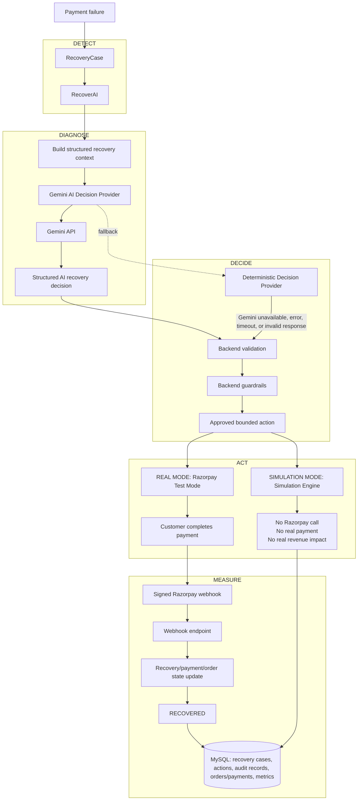

# NexCart RecoverAI — Razorpay Buildathon Track 03

RecoverAI is NexCart's bounded autonomous recovery module: `DETECT → DIAGNOSE → DECIDE → ACT → MEASURE`.

## NexCart RecoverAI — AI Revenue Recovery Architecture

### Gemini security boundary

Gemini is the recovery decision-maker, not the payment executor. It receives only safe structured recovery context and returns a bounded recommendation. It has no direct access to MySQL, database writes, Razorpay credentials, payment execution, order state changes, authentication, or authorization. The Spring Boot backend validates every AI response and applies guardrails before any action is executed.

Normal failed payments create a persistent `RecoveryCase`. When configured, Gemini analyzes safe structured recovery context and recommends only `RETRY_PAYMENT`, `CREATE_PAYMENT_LINK`, or `NO_ACTION`. The backend validates the JSON response and retains deterministic rules as `DETERMINISTIC_FALLBACK` for missing keys, timeout/API failures, malformed output, or invalid recommendations. Backend guardrails cap recovery at three attempts and payment retries at two; Gemini cannot modify money, orders, access control, database state, or external calls.

The module persists cases, actions and append-only audit records. Metrics include at-risk revenue, recovered revenue, recovery rate, expected recovery, and action distribution, filterable by real/simulated data. Use the admin-only `/admin/recovery` screen and its safe simulation to demo the same real engine.

Endpoints: `GET /api/admin/recovery/metrics`, `GET /api/admin/recovery/cases`, `GET /api/admin/recovery/cases/{id}`, `POST /api/admin/recovery/cases/{id}/analyze`, `POST /api/admin/recovery/cases/{id}/execute`, and `POST /api/admin/recovery/simulate`.

### Execution modes

| Mode | Flow | Outcome |
| --- | --- | --- |
| REAL | RecoverAI → Razorpay Test Mode → customer payment → signed webhook | The linked case becomes `RECOVERED` after verified payment. |
| SIMULATION | RecoverAI → Simulation Engine | No Razorpay call, no real payment, and no real revenue impact. |

Razorpay test-mode payment links reuse the existing SDK. `POST /api/webhooks/razorpay` validates the Razorpay signature using `RAZORPAY_WEBHOOK_SECRET`; invalid requests are rejected and successful payment events complete their linked recovery case.
